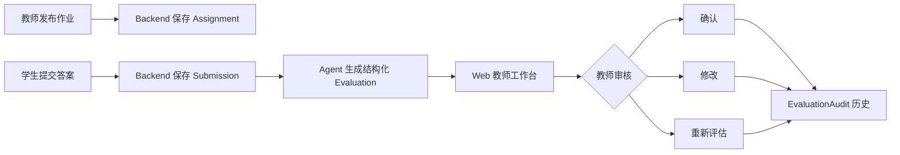
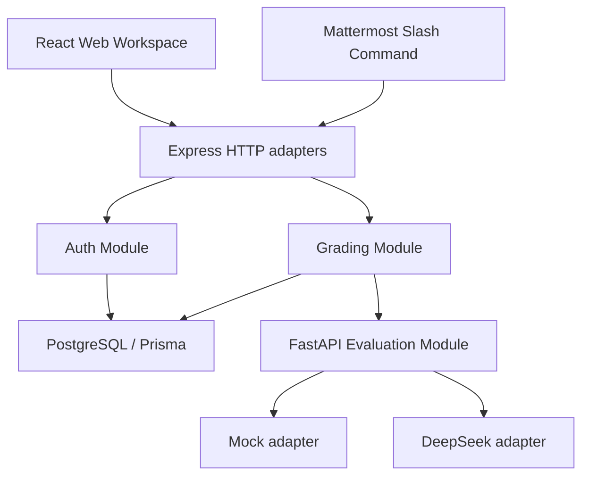

# Mattermost AI Assignment Grader

> TIDE 作业评估平台：一个可由课程团队自行部署的 AI 辅助作业评估系统。

[](https://github.com/NaCr05/mattermost-ai-assignment-grader/actions/workflows/ci.yml)
[](https://github.com/NaCr05/mattermost-ai-assignment-grader/actions/workflows/security.yml)
[](https://github.com/NaCr05/mattermost-ai-assignment-grader/releases/latest)
[](LICENSE)

Mattermost AI Assignment Grader 把学生提交、AI 结构化初评和教师最终审核连接成一条可追踪的工作流。当前版本使用 Mattermost 完成作业发布、学生提交和汇总，教师在 Web 工作台中确认、修改或重新评估；AI 只提供辅助意见，最终结论始终由教师负责。


> 截图只使用匿名合成内容，不包含 Seed、课程数据集或真实用户信息。

## 30 秒了解项目

| 问题 | 当前答案 |
|---|---|
| 谁使用 | 自行部署平台的课程团队、教师和学生 |
| 解决什么 | 把作业提交、AI 初评、教师复核和审计记录放在同一流程中 |
| 当前入口 | Mattermost 负责发布与提交，Web 负责教师审核和账号管理 |
| 如何部署 | 本地开发或单台服务器 Docker Compose |
| AI 模式 | 离线 Mock，或显式配置的 DeepSeek 在线模型 |
| 安全边界 | Pascal 执行默认关闭；AI 结果不能替代教师判断 |

### 当前能力与产品方向

当前 v0.1.x 是 **Mattermost 工作流 + Web 教师工作台**。长期方向是 **独立 Web 平台 + 可选 Mattermost adapter**：

- 教师将在 Web 中发布和管理作业；
- 学生将在 Web 中查看作业、提交答案和读取反馈；
- Mattermost 将保留为可选的发布、提交和通知入口。

这些 Web 自助流程属于后续版本规划；README 不把尚未实现的能力描述为当前功能。

## 5 分钟本地启动

### 环境

- Windows 10/11；
- Docker Desktop；
- PowerShell 5.1 或 PowerShell 7。

首次启动会从 `.env.example` 创建本地 `.env`，自动生成数据库密码、`AUTH_SECRET` 和一次性 `BOOTSTRAP_TOKEN`。不会加载 Seed 或课程数据集。

```powershell
powershell -ExecutionPolicy Bypass -File .\scripts\start-demo.ps1
powershell -ExecutionPolicy Bypass -File .\scripts\bootstrap-admin.ps1
```

第二个命令会交互式询问管理员用户名、显示名称和密码；密码至少 12 个字符。脚本不会提供默认凭据，也不会显示 Bootstrap Token 或密码。

完成后打开：

- Web 工作台：`http://localhost:5173`
- Backend 健康检查：`http://localhost:3001/health`
- Agent 健康检查：`http://localhost:8000/health`

默认 `AGENT_MODE=mock`，适合无网络、无 API Key 的本地验证。当前完整的作业发布与学生提交流程还需要配置 Mattermost，或直接调用受保护的 HTTP 接口。

Linux、手动 Compose、已有 `.env` 和常见启动问题见 [本地启动指南](docs/getting-started.md)。

## 一次评估如何流转



系统保证：

- Agent 暂时失败时不删除学生提交；
- 确认、修改和重评都携带 Evaluation 版本，过期写入返回冲突；
- EvaluationAudit 保存不可变的评估历史；
- 公开 DTO 不返回 Agent 原始输出、Token、成本或内部字段；
- Web 身份来自服务端会话，不接受客户端提供的用户 ID 作为权限依据。


## 核心能力

- 教师发布作业、查看提交汇总和审核状态；
- 学生提交文本、代码片段或伪代码答案；
- Agent 生成分数、等级、完整性、正确性、问题和修改建议；
- 教师确认、修改或重新评估；
- 作业搜索、提交搜索、状态与等级筛选、排序和统计；
- 平台账号创建、密码重置、禁用和全会话撤销；
- JSON 结构化日志、请求 ID、健康检查和 Prometheus 指标；
- Mock 与 DeepSeek adapter；
- 单机 Compose 生产部署、HTTPS、备份与恢复；
- CI、Security、Dependabot 和真实 Chromium smoke。

## 架构概览



| 目录 | 职责 |
|---|---|
| `backend/` | Express adapters、认证、Grading Module、Prisma |
| `frontend/` | React 会话入口、教师工作台、未来学生工作区 seam |
| `agent/` | FastAPI Evaluation Module、Mock/DeepSeek adapter |
| `scripts/` | 启动、初始化、验证、备份和恢复 |
| `tests/` | API、状态并发、浏览器 smoke 和合成验收 |
| `deploy/` | 单服务器 Caddy HTTPS 入口 |

更完整的数据流、模块 interface、身份模型和 HTTP 路由见 [架构说明](docs/architecture.md)。

## 部署方式

| 模式 | 适用场景 | 入口与隔离 |
|---|---|---|
| 本地开发 | 功能开发、Mock 验收 | 服务只绑定 `127.0.0.1` |
| 单机生产 Compose | 近期生产部署 | Caddy 是唯一公开入口；数据库、Backend、Agent 不映射端口 |

生产启动只执行 `prisma migrate deploy`，不会执行 Seed。所有生产容器使用非 root 用户，Pascal 执行保持默认关闭。

部署、HTTPS、初始化、备份和恢复见 [生产部署指南](docs/deployment.md)。

## Agent 与能力边界

- Mock 输出稳定但只是规则系统，不具备任意题型的通用语义理解；
- DeepSeek 模式需要显式 API Key，并通过 Pydantic 结构校验和一次失败重试；
- 在线模型仍可能受网络、限流、版本和随机性影响；
- Pascal 专项执行器不是安全沙箱，公开部署必须保持关闭；
- AI 结果仅供辅助，教师负责最终结论。

完整风险说明以 [CAPABILITY_BOUNDARIES.md](CAPABILITY_BOUNDARIES.md) 为准；模型模式、指标、成本和付费合成评估见 [Agent 运行指南](docs/agent.md)。

## 验证

提交或发布前在仓库根目录运行统一门禁：

```powershell
./scripts/verify.ps1
```

它验证 Backend、Frontend、Agent、PostgreSQL、真实 Chromium、空库 migration、生产静态入口、端口隔离、非 root 身份、Pascal 默认关闭、依赖审计以及备份恢复。它不执行 Seed，也不读取或整理课程数据集。

最新人工可读证据见 [tests/TEST_RESULTS.md](tests/TEST_RESULTS.md)。贡献者的局部测试和 PR 要求见 [CONTRIBUTING.md](CONTRIBUTING.md)。

## 文档导航

| 目标 | 文档 |
|---|---|
| 第一次在本地运行 | [docs/getting-started.md](docs/getting-started.md) |
| 配置 Mattermost 与 `/ds` | [docs/mattermost.md](docs/mattermost.md) |
| 理解模块、数据流和接口 | [docs/architecture.md](docs/architecture.md) |
| 配置 Agent、指标和真实模型评估 | [docs/agent.md](docs/agent.md) |
| 单机生产部署与恢复 | [docs/deployment.md](docs/deployment.md) |
| 查看演示步骤 | [DEMO_SCRIPT.md](DEMO_SCRIPT.md) |
| 查看能力边界 | [CAPABILITY_BOUNDARIES.md](CAPABILITY_BOUNDARIES.md) |
| 查看版本变化 | [CHANGELOG.md](CHANGELOG.md) |

## Roadmap

- [x] Grading Module 与 Agent seam；
- [x] 教师 Web 审核、并发保护和显式 DTO；
- [x] 平台账号、限速和会话撤销；
- [x] 单机生产 Compose 与统一验证；
- [ ] 教师 Web 作业发布与管理；
- [ ] 学生 Web 作业列表、提交和反馈；
- [ ] Mattermost 从必需工作流变为可选 adapter；
- [ ] 版本化容器镜像与更简化的生产安装。

## 开源与安全

- 许可证：[ISC License](LICENSE)
- 贡献方式：[CONTRIBUTING.md](CONTRIBUTING.md)
- 私密漏洞报告：[SECURITY.md](SECURITY.md)
- 第三方软件与素材：[THIRD_PARTY_NOTICES.md](THIRD_PARTY_NOTICES.md)

请勿提交 `.env`、API Key、Token、Cookie、真实课程名单、学生答案或内部地址。
