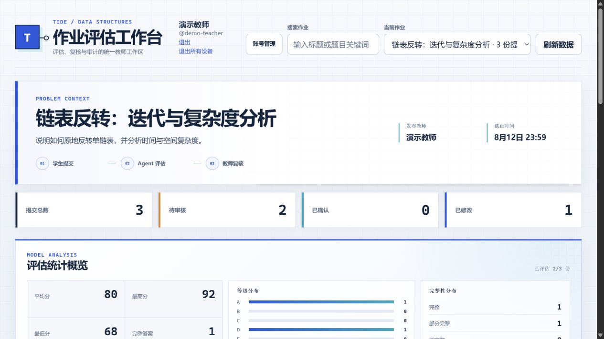
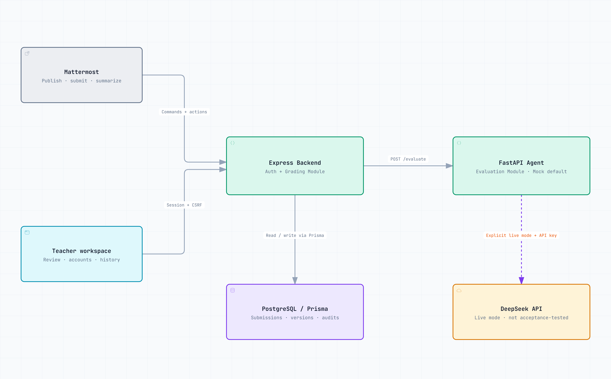
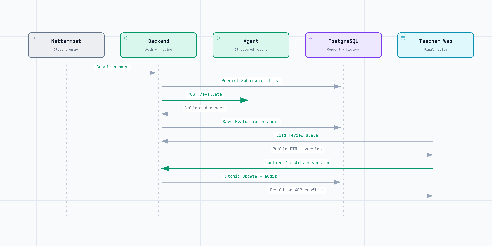
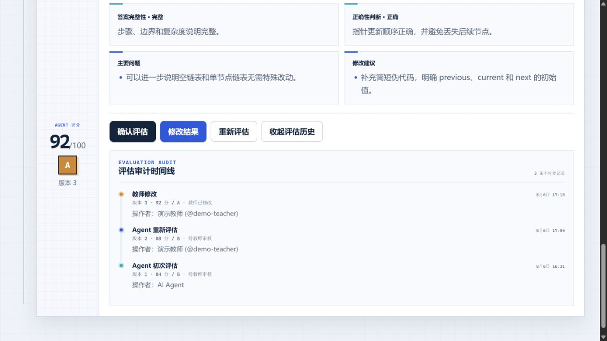

# Mattermost AI Assignment Grader

**English** | [简体中文](README.zh-CN.md)

> A self-hosted, AI-assisted assignment grading platform for course teams using Mattermost.

> **Maintenance mode.** `v0.2.0` freezes the current product scope. No new features are planned in the near term; only severe security, data-integrity, and release-blocking issues are considered. See [SECURITY.md](SECURITY.md).

[](https://github.com/NaCr05/mattermost-ai-assignment-grader/actions/workflows/ci.yml)
[](https://github.com/NaCr05/mattermost-ai-assignment-grader/actions/workflows/security.yml)
[](https://github.com/NaCr05/mattermost-ai-assignment-grader/releases/latest)
[](LICENSE)

Connect student submissions, structured AI feedback, and teacher review in one traceable workflow. Teachers publish assignments through Mattermost, students submit there, and teachers confirm, modify, or regrade evaluations in the Web workspace. AI provides assistance; teachers own the final judgment.



> Screenshots contain anonymous synthetic content only, with no seed datasets, course datasets, or real user information. The application screenshots retain the existing Chinese UI.

## Understand the project in 30 seconds

| Question | Current answer |
|---|---|
| Who uses it? | Course teams deploying their own platform, teachers, and students |
| What does it solve? | Submission, AI feedback, teacher review, and audit history in one workflow |
| Where do users start? | Mattermost for publishing and submission; Web for teacher review and accounts |
| How is it deployed? | Local development or single-server Docker Compose |
| Which AI modes exist? | Verified offline Mock; a DeepSeek adapter without formal live-model acceptance evidence |
| What are the boundaries? | Pascal execution is disabled by default; AI does not replace teacher judgment |

### Current product scope

`v0.2.0` is frozen as **Mattermost publishing/submission + a teacher Web workspace**:

- Teachers publish and summarize through Mattermost and can review evaluations and manage accounts on the Web.
- Students submit answers through Mattermost.
- The student Web entry verifies identity and directs the student back to the course entry point.

Teacher Web publishing, a full student Web workflow, and an optional Mattermost adapter are deferred, with no delivery commitment in this maintenance release.

## Architecture overview

<picture>
  <source media="(prefers-color-scheme: dark)" srcset="assets/readme/overview.en.dark.png">
  
</picture>

[View full-size diagram](assets/readme/overview.en.png)

| Directory | Responsibility |
|---|---|
| `backend/` | Express adapters, authentication, Grading Module, and Prisma |
| `frontend/` | React sessions, teacher workspace, and student identity notice |
| `agent/` | FastAPI Evaluation Module with Mock and DeepSeek adapters |
| `scripts/` | Startup, bootstrap, verification, backup, and restore |
| `tests/` | API, concurrent state updates, browser smoke, and synthetic acceptance |
| `deploy/` | Caddy HTTPS entry for a single server |

The overview shows application relationships, not production port exposure. See the [architecture guide](docs/architecture.md) for interfaces, identity, data flow, and HTTP routes.

## Local quick start

### Requirements

- Windows 10/11
- Docker Desktop
- PowerShell 5.1 or PowerShell 7

The first startup creates a local `.env` from `.env.example` and generates the database password, `AUTH_SECRET`, and a one-time `BOOTSTRAP_TOKEN`. It does not load seed or course datasets.

```powershell
powershell -ExecutionPolicy Bypass -File .\scripts\start-demo.ps1
powershell -ExecutionPolicy Bypass -File .\scripts\bootstrap-admin.ps1
```

The second command prompts for the administrator username, display name, and password. Passwords must contain at least 12 characters. No default credentials are supplied, and the script does not display the Bootstrap Token or password.

Then open:

- Web workspace: `http://localhost:5173`
- Backend health: `http://localhost:3001/health`
- Agent health: `http://localhost:8000/health`

The default `AGENT_MODE=mock` supports local verification without a network connection or API key. The complete publishing and submission workflow still requires Mattermost configuration, or direct use of the protected HTTP APIs.

For Linux, manual Compose setup, existing `.env` files, and troubleshooting, see [Getting started](docs/getting-started.md).

## From submission to teacher review

<picture>
  <source media="(prefers-color-scheme: dark)" srcset="assets/readme/review.en.dark.png">
  
</picture>

[View full-size diagram](assets/readme/review.en.png)

The diagram starts with a published assignment and shows a first submission, successful initial evaluation, and teacher confirmation or modification. Regrading calls the Agent again. Agent failures retain the submission; version conflicts reject stale changes. With the direct HTTP API, saving a submission and requesting evaluation are separate requests.

The system's implemented safeguards include:

- A temporary Agent failure does not delete the student's submission.
- Confirm, modify, and regrade requests carry the current Evaluation version; stale writes return a conflict.
- EvaluationAudit stores immutable evaluation history.
- Public DTOs exclude raw Agent output, token usage, cost, and internal fields.
- Web identity comes from server-side sessions; a client-supplied user ID is not an authorization source.



## Core capabilities

- Teacher assignment publishing, submission summaries, and review status
- Student answers as text, code snippets, or pseudocode
- Structured scores, grades, completeness, correctness, problems, and suggestions
- Teacher confirmation, modification, and regrading
- Assignment/submission search, status and grade filters, sorting, and statistics
- Account creation, password resets, disabling users, and revoking all sessions
- Structured JSON logs, request IDs, health checks, and Prometheus metrics
- Verified Mock behavior and a best-effort DeepSeek adapter
- Single-server Compose deployment, HTTPS, backup, and restore
- CI, Security, Dependabot, and real Chromium smoke tests

## Deployment

| Mode | Use | Entry and isolation |
|---|---|---|
| Local development | Development and Mock acceptance | Services bind to `127.0.0.1` |
| Single-server production Compose | Current production deployment model | Only Caddy is publicly exposed; database, Backend, and Agent publish no host ports |

Production startup runs `prisma migrate deploy`, without seeding data. All production containers run as non-root users, and Pascal execution remains disabled by default. Formal releases provide digest-pinned `release-images.env`, SBOMs, and checksums; production Compose does not build application images on the server.

See [Production deployment](docs/deployment.md) for HTTPS, bootstrap, backup, and restore.

## Agent modes and capability boundaries

- Mock is deterministic and rule-based. It does not provide general semantic understanding across arbitrary assignment types.
- DeepSeek requires an explicit API key and uses Pydantic output validation with one retry. There is no paid live-model acceptance evidence; this adapter remains unverified, best-effort support.
- Live behavior can vary with network conditions, rate limits, model versions, and randomness.
- The Pascal-specific executor is not a security sandbox and must remain disabled in public deployments.
- AI output is advisory; teachers remain responsible for the final assessment.

[CAPABILITY_BOUNDARIES.md](CAPABILITY_BOUNDARIES.md) is authoritative for limitations. See the [Agent guide](docs/agent.md) for mode selection, metrics, costs, and explicitly paid synthetic evaluation.

## Verification

Before a commit or release, run the unified gate from the repository root:

```powershell
./scripts/verify.ps1
```

It checks Backend, Frontend, Agent, PostgreSQL, real Chromium, empty-database migrations, the production static entry, port isolation, non-root users, restart/log policies, disabled Pascal execution, dependency audits, documentation links, and backup/restore. Linux CI also exercises production Bash backup and restore. The gate does not seed, read, or reorganize course datasets.

[tests/TEST_RESULTS.md](tests/TEST_RESULTS.md) records the human-readable validation from 2026-08-07. Use the CI and Security workflows above for current status: historical passes do not imply that current dependency scans pass. See [CONTRIBUTING.md](CONTRIBUTING.md) for focused tests and PR requirements.

## Documentation

Most detailed guides currently use Simplified Chinese.

| Goal | Guide |
|---|---|
| Run locally | [Getting started](docs/getting-started.md) |
| Configure Mattermost and `/ds` | [Mattermost](docs/mattermost.md) |
| Understand modules, data flow, and interfaces | [Architecture](docs/architecture.md) |
| Configure the Agent and live-model evaluation | [Agent](docs/agent.md) |
| Deploy and restore a single server | [Deployment](docs/deployment.md) |
| Take over the project | [Onboarding](docs/project-onboarding.md) |
| Review outcomes and remaining risks | [Retrospective](docs/project-retrospective.md) |
| Check capability boundaries | [Capability boundaries](CAPABILITY_BOUNDARIES.md) |
| View changes | [Changelog](CHANGELOG.md) |

## Maintenance status and frozen scope

The supported scope includes the Grading Module, Agent interface, teacher Web review, account/session security, single-server production Compose, immutable release images, and unified verification. The following are explicitly deferred and are not `v0.2.0` defects:

- Teacher Web assignment publishing and management
- Student Web assignment lists, submission, and feedback
- Making Mattermost an optional adapter
- Multiple Backend instances, shared rate limiting, and a highly available database
- Safe execution of arbitrary untrusted code

The repository remains readable and deployable, without a feature-roadmap commitment. [SECURITY.md](SECURITY.md) defines vulnerability reporting and version support.

## Open source and security

- License: [ISC](LICENSE)
- Contributions: [CONTRIBUTING.md](CONTRIBUTING.md)
- Private vulnerability reports: [SECURITY.md](SECURITY.md)
- Third-party software and assets: [THIRD_PARTY_NOTICES.md](THIRD_PARTY_NOTICES.md)

Do not commit `.env`, API keys, tokens, cookies, real course rosters, student answers, or internal addresses.
