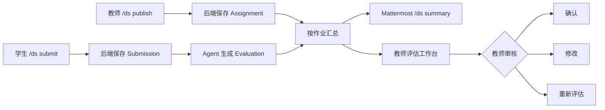

# TIDE 数据结构作业评估系统

[](https://github.com/NaCr05/mattermost-ai-assignment-grader/actions/workflows/ci.yml)
[](https://github.com/NaCr05/mattermost-ai-assignment-grader/actions/workflows/security.yml)
[](LICENSE)

一个可供课程团队自行部署的作业发布、提交、AI 辅助评估与教师审核平台。网页入口使用平台账号和服务端会话；Mattermost Slash Command 作为可选的独立交互入口。

## 已实现的完整流程



已支持：

- 教师通过 Mattermost 发布作业；
- 学生通过 Mattermost 提交文本、代码片段或伪代码答案；
- 提交后自动调用 Agent 生成结构化基础评估；
- 教师通过 Mattermost 查看作业汇总；
- Mattermost 汇总卡片支持“确认评估”和“重新评估”交互按钮；
- 教师在网页中确认、修改或重新评估；
- 教师工作台支持作业搜索、提交搜索、状态/等级筛选和多种排序；
- 教师工作台展示平均分、最高/最低分、等级分布和完整性分布；
- 教师工作台按提交展示不可变的 EvaluationAudit 评估历史时间线；
- Prisma + PostgreSQL 持久化；
- EvaluationAudit 记录 Agent 生成、教师修改、确认和重评历史；
- Agent 合约、状态并发、权限、DTO 和前端工作区自动测试；
- 后端输出带请求 ID、耗时和业务事件的 JSON 结构化日志；
- Agent 输出请求关联、耗时、重试、Token 和可配置成本估算，并提供内部 Prometheus 指标；
- 登录与 Bootstrap 双维度限速、数据库版本化全会话撤销；
- backend、agent、frontend、PostgreSQL 容器健康检查；
- Mock 与 DeepSeek 两种 Agent 运行模式。

## 项目结构

```text
.
├─ backend/       Express adapter + Grading Module + Prisma + 自动测试
├─ frontend/      React UI + Review Workspace Module + HTTP/Fake adapter
├─ agent/         FastAPI adapter + Evaluation Module + Mock/DeepSeek adapter
├─ tests/         合成验收、浏览器 smoke 与验证结果
├─ assets/        验收截图和演示素材
├─ scripts/       本地开发启动与验证脚本
├─ deploy/        单机生产 HTTPS 入口
├─ .github/       CI、安全扫描和 Dependabot
├─ docker-compose.yml
├─ docker-compose.smoke.yml
├─ docker-compose.prod.yml
├─ compose.base.yml
└─ .env.example
```

## 环境要求

- Windows 10/11
- Docker Desktop
- Node.js 24（推荐；本地构建和测试需要）
- WSL2 + Ubuntu
- 已能运行的 Mattermost 本地开发环境

## 一、本地开发环境

在项目根目录复制环境变量：

```powershell
Copy-Item .env.example .env
```

编辑 `.env`。密码和密钥必须替换，Pascal 执行保持关闭：

```dotenv
POSTGRES_USER=postgres
POSTGRES_PASSWORD=替换为本地强密码
POSTGRES_DB=tide_final
POSTGRES_PORT=5434

BACKEND_PORT=3001
FRONTEND_PORT=5173
AGENT_PORT=8000
FRONTEND_ORIGIN=http://localhost:5173

AUTH_SECRET=至少32字符的随机值
BOOTSTRAP_TOKEN=一次性初始化Token
AUTH_COOKIE_SECURE=false
AUTH_RATE_LIMIT_WINDOW_SECONDS=900
AUTH_LOGIN_IP_LIMIT=30
AUTH_LOGIN_ACCOUNT_LIMIT=8
AUTH_BOOTSTRAP_IP_LIMIT=5

AGENT_MODE=mock
ENABLE_PASCAL_EXECUTION=false
DEEPSEEK_API_KEY=your_api_key_here
DEEPSEEK_BASE_URL=https://api.deepseek.com
DEEPSEEK_MODEL=deepseek-v4-pro

MATTERMOST_SLASH_TOKEN=创建SlashCommand后生成的Token
MATTERMOST_TEACHER_USERNAME=你的Mattermost教师用户名
# 可选；Mattermost Server 能访问到的交互回调地址
MATTERMOST_ACTION_URL=
LOG_HEALTH_REQUESTS=false
LOG_ERROR_DETAILS=false
```

也可以直接运行启动脚本；如果 `.env` 不存在，脚本会从示例创建文件并自动生成本地 `AUTH_SECRET` 和 `BOOTSTRAP_TOKEN`：

```powershell
powershell -ExecutionPolicy Bypass -File .\scripts\start-demo.ps1
```

该脚本会检查 Docker、验证开发 Compose 配置、构建开发 target、启动容器、自动应用 Prisma migration，并等待三个 HTTP 服务可访问。它不会运行 Seed。Docker Hub 暂时不可访问但本地已有镜像时，脚本会自动回退到缓存镜像。

如果明确不需要重新构建，可执行：

```powershell
powershell -ExecutionPolicy Bypass -File .\scripts\start-demo.ps1 -NoBuild
```

也可以手动启动：

```powershell
docker compose up -d --build
docker compose ps
```

后端容器启动时会自动执行：

1. Prisma Client 生成；
2. 数据库迁移；
3. 后端开发服务器启动。

默认数据库为空。开发者只有在明确需要本地测试数据时才手动运行：

```powershell
docker compose exec backend npm run prisma:seed
```

该命令不是正常启动流程的一部分，生产镜像也不包含运行 TypeScript Seed 所需的开发工具。

检查：

```powershell
docker compose ps
Invoke-RestMethod http://localhost:3001/health
Invoke-RestMethod http://localhost:8000/health
```

`docker compose ps` 中的 db、agent、backend、frontend 最终都应显示为 `healthy`。

### 统一验证入口

提交或发布前运行：

```powershell
./scripts/verify.ps1
```

该脚本创建隔离的开发和生产 Compose 项目，运行 Backend、Frontend、Agent 全部检查，并用真实 Chromium 验证开发前端已经挂载且没有浏览器错误；随后验证 migration-only 空库、生产静态入口、端口限制、非 root UID、Pascal 默认关闭以及依赖审计，最后自动删除临时容器和命名卷。它不会执行 Seed，也不会读取或整理课程数据集。

页面与服务：

| 服务 | 地址 |
|---|---|
| 教师评估工作台 | `http://localhost:5173` |
| 后端健康检查 | `http://localhost:3001/health` |
| Agent 健康检查 | `http://localhost:8000/health` |
| Agent Prometheus 指标 | `http://localhost:8000/metrics` |
| Agent API 文档 | `http://localhost:8000/docs` |

开发配置中的 PostgreSQL、Backend、Agent 和 Frontend 都只绑定 `127.0.0.1`。后端宿主机端口使用 `3001`，避免与 Mattermost 开发环境的 Grafana `3000` 端口冲突。

### 生产运行模式

生产模式面向单台服务器 Compose：后端运行预构建 Node bundle，前端由 Nginx 提供静态文件，非 root Caddy 是唯一对外入口并自动申请和续期 HTTPS 证书。PostgreSQL、Backend、Agent 和 Frontend 均不映射宿主机端口，所有容器都以非 root 用户运行：

```powershell
Copy-Item .env.production.example .env.production
# 编辑 .env.production，设置域名、强密码、随机密钥和真实 HTTPS PUBLIC_ORIGIN
docker compose --env-file .env.production -f docker-compose.prod.yml up -d --build
docker compose --env-file .env.production -f docker-compose.prod.yml ps
```

把域名的 A/AAAA 记录指向该服务器并开放 TCP 80、TCP 443 和 UDP 443。`SITE_ADDRESS` 填写域名，`PUBLIC_ORIGIN` 填写完全一致的 `https://域名`；Caddy 负责 TLS，内部 Nginx 将 `/api/*` 转发到 Backend，并将 `/mattermost/*` 转发到 Mattermost adapter。数据库、Backend、Agent 和 Nginx 没有公开端口。

生产健康检查：

```powershell
Invoke-RestMethod https://你的域名/healthz
Invoke-RestMethod https://你的域名/api/health
Invoke-RestMethod https://你的域名/api/readyz
```

生产启动只执行 `prisma migrate deploy`，不会生成测试账号、作业、提交或评测，也不会执行 Seed。

### 备份与恢复演练

备份脚本使用 PostgreSQL custom format，不包含课程 Seed 或仓库数据集操作：

```powershell
.\scripts\backup.ps1 -EnvironmentFile .env.production
```

恢复脚本拒绝覆盖当前生产数据库，也拒绝覆盖任何已存在数据库。先恢复到一个新数据库并验证：

```powershell
.\scripts\restore.ps1 -EnvironmentFile .env.production `
  -BackupPath .\backups\tide-grader-YYYYMMDD-HHMMSS.dump `
  -TargetDatabase tide_restore_YYYYMMDD
```

确认迁移、账号、作业、提交和评估均正确后，才可把 `.env.production` 中的 `POSTGRES_DB` 切换到新数据库并重启 Compose。统一验证脚本会在隔离生产栈中自动执行一次空库备份/恢复演练，并删除该临时恢复数据库。

### 首次创建平台管理员

数据库迁移完成后，使用 `.env` 中的 `BOOTSTRAP_TOKEN` 创建第一个教师账号。该接口仅在数据库中还没有任何已设置密码的账号时可用：

```powershell
$headers = @{ "x-bootstrap-token" = "你的一次性初始化Token" }
$body = @{
  username = "admin"
  displayName = "平台管理员"
  password = "至少12字符的强密码"
} | ConvertTo-Json
Invoke-RestMethod -Method Post -Uri http://localhost:3001/auth/bootstrap `
  -Headers $headers -ContentType "application/json" -Body $body
```

完成后应从部署配置中移除或轮换 `BOOTSTRAP_TOKEN`。当前角色模型中教师同时承担平台账号管理职责：教师可在工作台的“账号管理”中查看账号、为其他用户重置密码、禁用或重新启用账号。重置密码和改变账号状态都会递增会话版本，使目标用户此前签发的 Cookie 全部失效；教师不能禁用自己的账号。创建用户、登录结果、密码重置、账号状态变更和全会话撤销都会写入 `AuthAudit`，不记录密码、答案、Token 或请求正文。

浏览器会话使用 HttpOnly Cookie，前端自动管理 CSRF Token。客户端传入的 `studentId`、`createdById` 或 `reviewedById` 不作为身份依据。“退出所有设备”同样会撤销此前签发的全部 Cookie。

登录按来源 IP 和规范化用户名分别限速，Bootstrap 也按来源 IP 限速。默认限速器保存在单个 Backend 进程内，适合当前单实例 Compose；多副本部署前应改为共享限速存储。

生产环境中的初始化地址为 `https://你的域名/api/auth/bootstrap`。

## 二、启动和配置 Mattermost

如果使用本地 Mattermost，可进入其开发环境：

```powershell
wsl -d Ubuntu
```

在 Mattermost 的 `server` 目录启动：

```bash
cd /你的/Mattermost源码路径/server
make run
```

不要在 `~/code/mattermost` 根目录运行 `make run`，该目录没有对应 target。

浏览器访问：

```text
http://localhost:8065
```

设置本地开发所需配置：

```bash
cd /你的/Mattermost源码路径/server
bin/mmctl config set ServiceSettings.SiteURL http://localhost:8065 --local
bin/mmctl config set ServiceSettings.AllowedUntrustedInternalConnections localhost,127.0.0.1 --local
```

确认 Slash Command 已启用：

```bash
bin/mmctl config get ServiceSettings.EnableCommands --local
```

应返回 `true`。

## 三、创建 `/ds` Slash Command

可在 Mattermost 集成页面创建，也可使用本地 `mmctl`：

```bash
cd /你的/Mattermost源码路径/server
bin/mmctl command create your-team \
  --local \
  --creator 你的Mattermost用户名 \
  --title TIDE-Assistant \
  --description TIDE-assignment-assistant \
  --trigger-word ds \
  --url http://localhost:3001/mattermost/commands \
  --response-username TIDE-Agent \
  --autocomplete \
  --autocompleteDesc TIDE-assignment-assistant \
  --autocompleteHint help-publish-submit-summary \
  --post
```

将命令生成的 Token 写入根目录 `.env`：

```dotenv
MATTERMOST_SLASH_TOKEN=生成的Token
```

Interactive Messages 的按钮回调地址默认根据 Slash Command 请求的 Host 自动生成。如果 Mattermost 无法访问自动生成的地址，可显式配置：

```dotenv
MATTERMOST_ACTION_URL=http://Windows主机在WSL中的可达IP:3001/mattermost/actions
```

该地址必须能从 Mattermost Server 所在的 WSL 环境访问，不能盲目填写 Mattermost Server 自己的 `localhost:3001`。

然后让后端读取新配置：

```powershell
docker compose up -d --force-recreate backend
```

不要把 `.env` 或真实 Token 提交到 Git。

## 四、角色与账号

平台账号包含教师和学生两种角色。首位教师通过 `/auth/bootstrap` 创建，后续账号由教师通过受保护的 `/auth/users` 接口创建。Mattermost 优先按 `mattermostUserId` 或同名平台用户名映射；`MATTERMOST_TEACHER_USERNAME` 只用于首次建立教师映射。仓库中的 Seed 和课程样例仅用于开发者显式执行的本地测试，不是生产账号源，也不会被任何默认启动命令加载。

## 五、Slash Command 用法

查看帮助：

```text
/ds help
```

教师发布：

```text
/ds publish | 标题 | 2026-07-25 23:59 | 题目内容 | 其他说明
```

学生提交：

```text
/ds submit | assignment_id | 答案内容
```

教师汇总：

```text
/ds summary | assignment_id
```

学生提交成功后，系统会保存答案并自动请求 Agent。Agent 暂时失败时，提交不会丢失，教师可在网页端重新评估。

教师执行汇总后，每份已有评估的提交会显示两个 Interactive Messages 按钮：

- **确认评估**：直接确认当前分数并追加 `confirmed` 审计记录；
- **重新评估**：立即返回“已触发”提示，后台调用 Agent，完成后追加 `regraded` 审计记录。

按钮上下文使用 `MATTERMOST_SLASH_TOKEN` 生成 HMAC 签名；回调还会重新检查 Mattermost 用户映射和教师角色。修改分数与评语仍在网页端完成。

## 六、教师审核

打开：

```text
http://localhost:5173
```

先使用平台教师账号登录，再从顶部核对当前作业。每份报告支持：

- **确认评估**：接受当前 Agent 结果；
- **修改结果**：修改分数、等级和评语；
- **重新评估**：再次调用 Agent，并递增报告版本。
- **查看评估历史**：展开该提交的 EvaluationAudit 时间线，核对操作类型、报告版本、分数、等级、状态、操作者和时间。

工作台还提供：

- 在顶部按作业标题或题目内容搜索作业；
- 按学生姓名、用户名或答案内容搜索提交；
- 按审核状态和等级筛选提交；
- 按提交时间、分数或学生姓名排序；
- 汇总已评估数量、平均分、最高分、最低分、等级分布和答案完整性分布。

统计与筛选均基于当前所选作业的数据，切换作业或点击“刷新数据”后会自动更新。筛选只改变前端显示，不修改数据库中的提交或评估。

前端默认可能停留在旧作业。操作前务必核对作业标题、学生和答案内容。

## 七、主要 API

| 方法 | 路径 | 用途 |
|---|---|---|
| GET | `/health` | 服务和数据库健康检查 |
| GET | `/readyz` | 数据库与 Agent 整体就绪检查 |
| POST | `/auth/bootstrap` | 仅首次创建平台教师账号 |
| POST | `/auth/login` | 登录并签发 HttpOnly 会话 |
| GET | `/auth/me` | 读取当前会话身份和 CSRF Token |
| POST | `/auth/logout` | 退出当前会话 |
| POST | `/auth/sessions/revoke` | 撤销该账号此前签发的全部会话 |
| GET | `/auth/users` | 教师查看平台账号 |
| POST | `/auth/users` | 教师创建平台账号 |
| POST | `/auth/users/:id/password-reset` | 教师重置目标账号密码并撤销旧会话 |
| PATCH | `/auth/users/:id/status` | 教师禁用或重新启用目标账号 |
| POST | `/assignments` | 教师发布作业 |
| GET | `/assignments` | 作业列表 |
| GET | `/assignments/:id` | 作业详情 |
| POST | `/assignments/:id/submissions` | 学生提交 |
| GET | `/assignments/:id/submissions` | 按作业汇总 |
| POST | `/submissions/:id/evaluate` | 生成基础评估 |
| GET | `/submissions/:id/evaluation` | 查询评估 |
| GET | `/submissions/:id/evaluation-audits` | 查询该提交的完整评估审计历史 |
| POST | `/evaluations/:id/confirm` | 教师确认 |
| PATCH | `/evaluations/:id` | 教师修改 |
| POST | `/evaluations/:id/regrade` | 教师要求重评 |
| POST | `/mattermost/commands` | Mattermost Slash Command 回调 |
| POST | `/mattermost/actions` | Mattermost Interactive Messages 安全回调 |

除健康检查、登录初始化和 Mattermost 回调外，Web API 均要求有效会话；写操作还要求 CSRF Token。教师只能管理自己发布的作业，学生只能访问自己的提交。

### EvaluationAudit 审计记录

系统在下列操作完成后追加不可变审计记录：

- `baseline`：迁移时保存已有评估的基线快照；
- `generated`：首次生成 Agent 评估；
- `modified`：教师修改评估；
- `confirmed`：教师确认评估；
- `regraded`：Agent 重新评估完成。

每条记录保存操作类型、评估版本、完整结果快照、Agent 原始输出、操作教师和时间。查询示例：

```powershell
Invoke-RestMethod `
  http://localhost:3001/submissions/你的提交ID/evaluation-audits |
  ConvertTo-Json -Depth 8
```

重评或学生重新提交不会覆盖已有审计记录；Evaluation 被替换时，历史仍按 Submission 保留。

## 八、运行验收测试

保持 Agent 容器运行，在项目根目录执行：

```powershell
node .\tests\run_acceptance_tests.mjs
```

预期：

```text
Acceptance cases: 6/6 matched documented behavior.
```

测试覆盖：

1. 正常完整答案；
2. 部分正确答案；
3. 明显错误答案；
4. 不完整或模糊答案；
5. Agent 误判；
6. 默认关闭代码执行时的稳定边界行为。

详细结果见 [tests/TEST_RESULTS.md](tests/TEST_RESULTS.md)。

### 快速单元检查

这些检查不需要启动数据库：

```powershell
cd backend
npm test
npm run typecheck

cd ..\frontend
npm test
npm run lint
npm run build

cd ..
python -m unittest discover -s agent -p "test_*.py" -v
```

### 正式 API 集成测试

保持四个 Compose 服务运行，推荐将 Agent 设为 Mock 后执行：

```powershell
docker compose exec backend npm run test:api
```

预期：

```text
tests 20
pass 20
fail 0
```

测试覆盖健康检查与请求 ID、参数校验、角色权限、发布、提交、首次评估、失败恢复、并发重评、乐观锁、教师修改、确认、显式 DTO 投影、汇总、EvaluationAudit、Slash Token、版本绑定的交互按钮签名和有效回调。每次使用唯一作业 ID，结束后自动删除测试作业及其级联数据，不污染演示列表。

### 结构化日志

后端将日志以“一行一个 JSON 对象”写入标准输出：

```powershell
docker compose logs -f backend
```

常见事件包括：

- `http.request.completed`：请求 ID、方法、路径、状态码、耗时；
- `evaluation.started/completed/failed`：提交、版本、模型提供方、分数和耗时；
- `mattermost.command_received`：Slash 子命令和角色；
- `mattermost.action_received/completed`：交互按钮操作与教师身份；
- `mattermost.action_signature_rejected`：伪造或过期按钮上下文被拒绝。

日志不会记录 Slash Token、API Key 或完整请求体；上游错误消息与堆栈也默认脱敏。Docker 探针请求默认不记录；受控本地排查时可按需设置 `LOG_HEALTH_REQUESTS=true` 或 `LOG_ERROR_DETAILS=true`，公开部署不要开启详细错误日志。

## 九、Agent 模式

### Mock 模式

```dotenv
AGENT_MODE=mock
```

特点：

- 不需要网络和 API Key；
- 输出稳定，适合本地验收演示；
- 本质是关键词规则，不是通用语义模型。

### DeepSeek 模式

```dotenv
AGENT_MODE=live
DEEPSEEK_API_KEY=你的Key
DEEPSEEK_BASE_URL=https://api.deepseek.com
DEEPSEEK_MODEL=deepseek-v4-pro
```

修改后重建：

```powershell
docker compose up -d --build agent backend
```

在线模式使用结构化提示词、Pydantic 校验，并在输出校验失败时重试一次。

Agent 会记录 Provider、模型、Prompt 版本、耗时、尝试次数和 Token 用量，但不会把学生答案或原始模型输出写入指标。每次成功评估还会把模型、Prompt 版本、Agent 请求 ID、Token、耗时和估算成本持久化到内部 `Evaluation` 字段，用于复现和运营审计；这些字段不会进入公开评估 DTO。费用估算默认关闭；如需启用，请根据供应商当前价格填写：

```dotenv
DEEPSEEK_INPUT_COST_PER_MILLION_USD=0
DEEPSEEK_OUTPUT_COST_PER_MILLION_USD=0
```

真实模型评估涉及付费调用，不进入普通 CI。确认 Agent 已以 `live` 模式运行后，可以在本地显式授权执行 18 个匿名合成用例，其中 15 个覆盖中英文正确/错误答案、模糊回答和提示词注入，3 个验证非法输入被拒绝：

```powershell
$env:ALLOW_PAID_LIVE_EVALUATION="true"
$env:AGENT_URL="http://127.0.0.1:8000"
python ./tests/run_live_model_evaluation.py
```

默认门禁为通过率不低于 80%、P95 延迟不高于 90 秒、总估算成本不超过 1 美元；均可通过 `LIVE_EVAL_*` 环境变量调整。脚本不读取 Seed 或课程数据集，也不把题目、答案或模型原始输出写入摘要。

GitHub 的 `Live model evaluation` workflow 只能手动触发，并要求勾选付费确认。仓库 Environment `live-model-evaluation` 需要配置 `DEEPSEEK_API_KEY` secret；模型、Base URL 和单价可配置为同名 Variables。workflow 只保存脱敏 JSON 摘要 30 天，不参与普通 PR 和 push。

## 十、能力边界

- Mock 规则主要针对当前单链表反转样例；
- 不能可靠理解任意数据结构题；
- 通用文本评估不会编译或运行任意学生代码，也没有通用隐藏测试；
- Pascal 专项代码执行默认关闭，关闭时返回结构化禁用结果且不会调用 `exec`；
- 只有隔离且受控的本地验收才可设置 `ENABLE_PASCAL_EXECUTION=true`；即使开启也不是真正的安全沙箱，不得执行不可信公开输入；
- 同义表达或纯中文表达可能被关键词规则误判；
- 堆叠正确关键词的错误代码可能获得高分；
- 在线模型输出仍可能不稳定；
- AI 结果只作辅助，最终结论由教师确认。

本次真实演示中，正确的括号匹配答案被 Mock Agent 评为 55/F，教师随后修改为 95/A，并成功执行重新评估。这一记录用于展示系统的真实能力边界。

## 十一、常见故障

### `SiteURL must be configured to use slash commands`

设置：

```bash
bin/mmctl config set ServiceSettings.SiteURL http://localhost:8065 --local
```

### `Command with a trigger of 'ds' failed` / `address forbidden`

设置仅限本机的集成白名单：

```bash
bin/mmctl config set ServiceSettings.AllowedUntrustedInternalConnections localhost,127.0.0.1 --local
```

### `Bind for 0.0.0.0:3000 failed`

Grafana 使用了 3000。本项目后端应保持：

```dotenv
BACKEND_PORT=3001
```

### `nc: bad address 'grafana'`

Mattermost 首次启动中断后，Grafana 可能没有加入 `mattermost-server_mm-test` 网络。检查：

```powershell
docker network inspect mattermost-server_mm-test
```

必要时把 `mattermost-grafana` 重新接入该网络并设置别名 `grafana`。

### 产品通知或安全更新超时

本地环境无法访问 Mattermost 外网服务时会出现警告，不影响核心 Demo。以页面是否能打开以及 `/api/v4/system/ping` 是否返回 `OK` 为准。

### Docker Hub TLS / x509 证书异常

如果 `docker compose up -d --build` 在拉取基础镜像元数据时出现：

```text
failed to fetch oauth token
tls: failed to verify certificate
x509: certificate is valid for another domain, not auth.docker.io
```

这是当前网络、代理或 DNS 导致的 Docker Hub 证书异常，不是项目代码构建失败。若本机已有之前成功构建的镜像，可先恢复服务：

```powershell
docker compose up -d --no-build
```

不要删除本地镜像或数据库卷。待网络恢复后再执行完整 `--build`。

## 十二、停止与数据保护

停止本地开发环境：

```powershell
docker compose down
```

停止生产环境：

```powershell
docker compose --env-file .env.production -f docker-compose.prod.yml down
```

不要执行下面命令，除非明确要删除所有作业与评估数据：

```powershell
docker compose down -v
```

开发与生产使用不同 Compose 项目名和命名卷。重新启动不会丢失业务数据，两个环境之间也不会共享数据库卷。

## 十三、开源治理与安全

- 许可证：[LICENSE](LICENSE)
- 贡献方式：[CONTRIBUTING.md](CONTRIBUTING.md)
- 私密漏洞报告：[SECURITY.md](SECURITY.md)
- 版本变化：[CHANGELOG.md](CHANGELOG.md)
- 第三方依赖与素材：[THIRD_PARTY_NOTICES.md](THIRD_PARTY_NOTICES.md)

CI 使用统一验证脚本；Security workflow 扫描完整 Git 历史中的密钥，并检查依赖漏洞、配置错误和高危文件系统问题。Dependabot 每周检查 npm、Python、Docker 和 GitHub Actions 更新。
