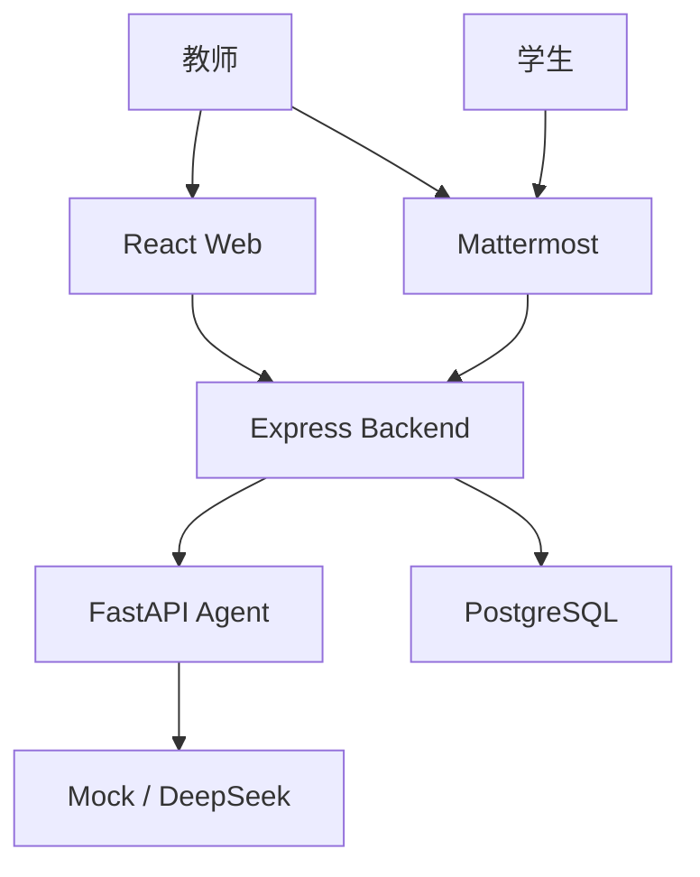

# 架构说明

本文描述当前已实现的系统结构、Module interface、数据流和身份模型。产品入口与路线图见 [README](../README.md)，完整安全限制见 [CAPABILITY_BOUNDARIES.md](../CAPABILITY_BOUNDARIES.md)。

## 系统上下文



### 当前用户路径

| 角色 | 当前入口 | 当前操作 |
|---|---|---|
| 教师 | Mattermost | 发布、汇总、确认、重评 |
| 教师 | Web | 登录、筛选、统计、确认、修改、重评、审计、账号管理 |
| 学生 | Mattermost | 提交答案 |
| 学生 | Web | 仅验证身份并提示使用课程入口 |

长期方向是为教师和学生补齐 Web 自助流程，再把 Mattermost 变为可选 adapter。该方向尚未作为当前能力发布。

## 主要 Module

### Grading Module

位置：`backend/src/grading/`。

它把首次评估、确认、教师修改、重新评估、状态迁移、乐观锁和审计追加收敛到一个 interface 后面。HTTP 和 Mattermost adapters 都调用该 Module，不维护第二套评分规则。

关键约束：

- Evaluation 版本单调递增；
- 旧版本修改返回冲突；
- 同一 Evaluation 只有一个并发重评能够取得执行权；
- 失败重评同时更新 Submission 和 Evaluation 的失败状态；
- 每次有效改变追加 EvaluationAudit。

### Auth Module

位置：`backend/src/auth/`。

负责：

- 首位管理员 Bootstrap；
- 用户名/密码登录；
- HttpOnly 会话 Cookie；
- CSRF Token；
- 教师与学生角色；
- 登录和 Bootstrap 限速；
- 数据库会话版本与全会话撤销；
- AuthAudit。

Web 请求中的用户 ID 不是权限依据。当前用户从服务端会话取得。

### Evaluation Module

位置：`agent/`。

Evaluation Module 接受评分上下文，选择 Provider adapter，校验结构化输出并返回稳定 DTO。当前有两个 adapter：

- Mock：本地、稳定、无需网络；
- DeepSeek：远程模型、结构化提示词、一次失败重试。

Backend 通过 HTTP adapter 调用 Agent；测试使用 Fake Agent 或 Mock adapter。

### Frontend Workspace

位置：`frontend/src/`。

前端 seam 分为：

- `App`：只负责会话状态和角色路由；
- `LoginScreen`：登录；
- `TeacherWorkspace`：教师审核页面；
- `StudentWorkspace`：当前学生入口与未来学生自助页面 seam；
- `AdminAccountPanel`：账号管理；
- `useReviewWorkspace`：教师工作区状态与操作 interface；
- `GradingGateway`：HTTP 和 Fake adapters 的共同 interface。

页面模块通过 `useReviewWorkspace` 的 interface 使用评分能力，测试不需要了解其内部请求时序。

## 核心数据流

### 发布和提交

1. 教师身份 adapter 请求发布 Assignment；
2. Backend 从身份上下文确定创建者；
3. 学生提交 Submission；
4. Backend 从身份上下文确定学生；
5. Submission 保存后请求首次 Evaluation；
6. Agent 失败时保留 Submission。

### 教师审核

1. Web 加载当前教师可管理的 Assignment；
2. 加载 SubmissionSummary；
3. 教师操作携带当前 Evaluation 版本；
4. Grading Module 原子更新当前版本；
5. 版本冲突返回 409；
6. 成功后追加 EvaluationAudit；
7. Web 重新投影当前队列和历史。

## 核心实体

| 实体 | 用途 |
|---|---|
| `User` | 平台教师或学生身份 |
| `Assignment` | 作业题目、截止时间和创建者 |
| `Submission` | 学生答案和评估生命周期状态 |
| `Evaluation` | 当前结构化评估及版本 |
| `EvaluationAudit` | 不可变评估历史 |
| `AuthAudit` | 登录、账号和会话安全事件 |

数据库 Schema 以 `backend/prisma/schema.prisma` 为权威来源。README 和本文只解释其用途。

## HTTP 路由

| 方法 | 路径 | 用途 |
|---|---|---|
| GET | `/health` | Backend 与数据库健康 |
| GET | `/readyz` | 数据库与 Agent 整体就绪 |
| POST | `/auth/bootstrap` | 创建首位教师 |
| POST | `/auth/login` | 登录 |
| GET | `/auth/me` | 当前会话和 CSRF Token |
| POST | `/auth/logout` | 退出当前会话 |
| POST | `/auth/sessions/revoke` | 撤销全部旧会话 |
| GET/POST | `/auth/users` | 教师查看或创建账号 |
| POST | `/auth/users/:id/password-reset` | 管理员重置密码 |
| PATCH | `/auth/users/:id/status` | 禁用或启用账号 |
| GET/POST | `/assignments` | 查询或发布作业 |
| GET | `/assignments/:id` | 作业详情 |
| GET/POST | `/assignments/:id/submissions` | 汇总或提交 |
| POST | `/submissions/:id/evaluate` | 生成首次评估 |
| GET | `/submissions/:id/evaluation` | 当前评估 |
| GET | `/submissions/:id/evaluation-audits` | 评估历史 |
| POST | `/evaluations/:id/confirm` | 教师确认 |
| PATCH | `/evaluations/:id` | 教师修改 |
| POST | `/evaluations/:id/regrade` | 教师重评 |
| POST | `/mattermost/commands` | Slash Command adapter |
| POST | `/mattermost/actions` | Interactive Message adapter |

路由和 DTO 的实现是当前行为权威来源。变更公开路径、状态码、DTO、数据库 Schema 或 Mattermost 协议时，必须在 PR 和 CHANGELOG 中说明兼容性影响。

## EvaluationAudit

动作类型：

- `baseline`：已有评估迁移基线；
- `generated`：首次 Agent 评估；
- `modified`：教师修改；
- `confirmed`：教师确认；
- `regraded`：Agent 重新评估。

审计记录保存版本、快照、操作者和时间。公开投影会移除密码、Token、Agent 原始输出和未来新增的私有字段。

## 部署拓扑

### 开发

```text
Host 127.0.0.1
├─ Frontend :5173
├─ Backend  :3001
├─ Agent    :8000
└─ PostgreSQL :5434
```

### 生产

```text
Internet
└─ Caddy :80/:443
   ├─ Nginx static frontend
   ├─ Backend
   ├─ Agent
   └─ PostgreSQL
```

生产内部模块没有宿主机端口映射。详情见 [部署指南](deployment.md)。

## 验证权威关系

| 声明 | 主要证据 |
|---|---|
| Module 状态行为 | Backend unit/integration tests |
| 公开 DTO 不泄露内部字段 | `grading-dto.test.ts` 和 API tests |
| 前端状态一致性 | hook tests 和 Chromium smoke |
| Agent 合约 | Agent unit tests 与合成验收 |
| 生产隔离 | `scripts/verify.ps1` |
| 当前人工可读结果 | `tests/TEST_RESULTS.md` |

统一入口是 `./scripts/verify.ps1`。
