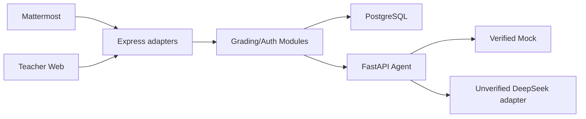

# 项目接手指南：Mattermost AI Assignment Grader

## 两分钟概览

这是一个可自托管的 AI 辅助作业评估平台。Mattermost 是当前作业发布和学生提交入口，React Web 是教师审核、审计和账号管理入口。Express Backend 维护身份、权限和评估状态，FastAPI Agent 生成结构化辅助意见，PostgreSQL 保存业务与审计数据。

项目自 `v0.2.0` 起处于维护模式：当前范围被冻结，只评估严重安全、数据完整性和发布阻塞问题。Mock Agent 是已验证路径；DeepSeek adapter 已实现但没有付费真实模型验收证据。AI 不能替代教师判断。

最短心智模型：

> Mattermost/Web 是 adapters，Backend 的 Grading/Auth Modules 定义业务真相，Agent 是可替换评分端口，Prisma Schema 和自动测试定义持久化与行为契约。

## 目标用户与核心流程

| 用户 | 当前入口 | 核心任务 |
|---|---|---|
| 课程教师 | Mattermost、Web | 发布、汇总、审核、重评、账号管理 |
| 学生 | Mattermost | 提交文本、代码片段或伪代码答案 |
| 单机部署者 | Linux 服务器 | 配置 HTTPS、备份、监控和恢复演练 |

主流程：教师在 Mattermost 发布 Assignment，学生提交 Submission，Backend 保存提交并请求 Agent，Agent 返回结构化 Evaluation，教师在 Web 确认、修改或重评，Backend 追加不可变 EvaluationAudit。

## 技术栈与架构

| 层 | 技术 | 职责 |
|---|---|---|
| Web | React、Vite、TypeScript | 会话、教师审核、审计和账号管理 |
| Backend | Node.js、Express、TypeScript | HTTP/Mattermost adapters、认证和评分业务 |
| 数据 | PostgreSQL、Prisma | 业务状态、版本竞争和审计 |
| Agent | Python、FastAPI、Pydantic | Mock/DeepSeek adapter 和结构化输出校验 |
| 边缘 | Caddy、Nginx | HTTPS 入口和静态文件 |
| 自动化 | Docker Compose、PowerShell、Bash、GitHub Actions | 验证、发布、备份和安全扫描 |



详细边界见 [架构说明](architecture.md)。

## 目录地图与关键入口

| 路径 | 用途 | 什么时候从这里开始 |
|---|---|---|
| `README.md` | 产品入口、冻结范围、文档路由 | 第一次了解项目 |
| `backend/src/app.ts` | Backend 装配入口 | 查 HTTP 中间件与 adapter 挂载 |
| `backend/src/grading/` | 评分生命周期 interface | 修改评估、审核、并发或 DTO |
| `backend/src/auth/` | 身份、会话、限速和账号 | 修改登录或权限 |
| `backend/prisma/schema.prisma` | 数据库 Schema 权威来源 | 修改持久化结构 |
| `frontend/src/App.tsx` | 会话和角色路由 | 查登录后的页面选择 |
| `frontend/src/workspace/` | 教师审核界面 | 修改工作台展示与交互 |
| `agent/evaluation_module.py` | Agent 用例入口 | 修改评分编排 |
| `agent/provider_port.py` | Provider interface | 增加或替换模型 adapter |
| `compose.base.yml` | 共享运行契约 | 查环境变量、健康检查和日志 |
| `docker-compose.yml` | 本地源码构建 | 本地开发 |
| `docker-compose.prod.yml` | digest 镜像生产部署 | 单机生产运行 |
| `scripts/verify.ps1` | 统一验证权威入口 | 提交或发布前 |
| `scripts/backup.sh` | Linux 原子备份 | 配置服务器日常运维 |
| `scripts/restore-drill.sh` | Linux 恢复演练 | 验证备份可恢复 |
| `.github/workflows/` | CI、安全、模型评估和镜像发布 | 查 GitHub 自动化 |
| `tests/TEST_RESULTS.md` | 最近一次人工可读证据 | 判断当前验证状态 |

Seed、课程数据集和本地官方验收输入不是平台运行依赖，不要整理或发布它们。

## 数据流

一次学生提交按以下路径流转：

1. Mattermost adapter 校验 Token/HMAC，并把外部用户映射到平台身份；
2. Backend 验证 Assignment、权限和输入，保存 Submission；
3. Grading Module 通过 Agent port 请求首次 Evaluation；
4. Agent 选择 Mock 或配置的 Provider，校验输入和结构化输出；
5. Backend 持久化 Evaluation；失败时保留 Submission 并记录失败状态；
6. Web 只读取显式公开 DTO；教师操作必须携带 Evaluation 版本；
7. 数据库条件更新解决并发竞争，成功操作追加 EvaluationAudit。

Schema 以 `backend/prisma/schema.prisma` 为准，路由与 DTO 以 Backend 实现和测试为准，不要把 README 当成可生成代码的协议规范。

## 安装、运行与测试

### 前置条件

本地开发需要 Windows 10/11、Docker Desktop、Git 和 PowerShell 5.1/7。生产需要 `linux/amd64`、Docker Compose v2、systemd、域名和可信管理员工作站。

### 安装

```powershell
git clone https://github.com/NaCr05/mattermost-ai-assignment-grader.git
Set-Location .\mattermost-ai-assignment-grader
```

### 配置

本地脚本会创建被 Git 忽略的 `.env`。重要变量名包括：

- 数据库：`POSTGRES_USER`、`POSTGRES_PASSWORD`、`POSTGRES_DB`；
- Web 安全：`AUTH_SECRET`、`BOOTSTRAP_TOKEN`、`PUBLIC_ORIGIN`；
- Agent：`AGENT_MODE`、`ENABLE_PASCAL_EXECUTION`、`DEEPSEEK_API_KEY`；
- Mattermost：`MATTERMOST_SLASH_TOKEN`、`MATTERMOST_ACTION_URL`；
- 运行：`LOG_MAX_SIZE`、`LOG_MAX_FILES`；
- 发布镜像：`BACKEND_IMAGE`、`AGENT_IMAGE`、`FRONTEND_IMAGE`、`CADDY_IMAGE`，由 Release 的 `release-images.env` 提供。

不要在文档、Issue、截图或日志中写入变量值。

### 运行

本地首次启动：

```powershell
powershell -ExecutionPolicy Bypass -File .\scripts\start-demo.ps1
powershell -ExecutionPolicy Bypass -File .\scripts\bootstrap-admin.ps1
```

脚本只执行 migration，不执行 Seed。完整步骤见 [本地启动指南](getting-started.md)。生产必须按 [单机部署指南](deployment.md) 使用 Release digest 镜像，不要在服务器上执行 `--build`。

### 测试与验证

```powershell
./scripts/verify.ps1
```

成功信号是最后输出 `All TIDE verification gates passed.`。该命令会创建隔离 Compose 项目和临时数据库，完成后清理；不会读取 Seed 或课程数据集。当前实际运行结果见 [TEST_RESULTS](../tests/TEST_RESULTS.md)。

只检查文档链接：

```powershell
./scripts/check-doc-links.ps1
```

真实模型评估会产生费用，不属于普通验证。没有明确授权、合成输入和 API Key 时不要运行。

## 常见开发任务

| 任务 | 修改位置 | 命令或验证 |
|---|---|---|
| 修改评分状态 | `backend/src/grading/` | Backend unit/API/state tests，再运行统一门禁 |
| 修改公开 DTO | `backend/src/grading/dto.ts` | `grading-dto.test.ts` 与 API tests |
| 修改教师工作台 | `frontend/src/workspace/` | Vitest、lint、Chromium smoke |
| 修改身份与账号 | `backend/src/auth/`、`frontend/src/auth/` | auth/rate-limit tests 与浏览器登录 |
| 修改 Agent 输出 | `agent/models.py`、`agent/evaluation_module.py` | Agent unit tests 与合成验收 |
| 修改生产 Compose | `compose.base.yml`、`docker-compose.prod.yml` | `scripts/verify.ps1` 的生产隔离检查 |
| 发布维护版本 | package versions、`CHANGELOG.md`、语义化 tag | PR 的 CI/Security，随后 Release images workflow |
| 验证备份 | `scripts/backup.sh`、`scripts/restore-drill.sh` | Linux CI 和季度生产恢复演练 |

## 易错点与排障

| 现象 | 常见原因 | 检查 | 处理 |
|---|---|---|---|
| 生产 Compose 提示缺少 `BACKEND_IMAGE` | 没有加载 Release 镜像清单 | 检查 `release-images.env` | 同时传入两个 `--env-file` |
| 首次登录提示已初始化 | 已存在设置密码的账号 | 查看已有教师账号 | 使用已有账号或由教师重置密码，不删除数据库 |
| 学生登录 Web 后没有作业列表 | 当前学生 Web 只是提示页 | 查看 README 冻结范围 | 使用 Mattermost 课程入口 |
| Agent 返回失败 | Provider 超时、限流或输出不合法 | 查请求 ID 和 Agent 日志 | 保留提交后重试；不要绕过结构校验 |
| DeepSeek 结果不符合预期 | 在线模式没有发布验收保证 | 运行脱敏 live eval | 回退 Mock 或由教师人工修改 |
| Pascal 代码未执行 | 生产默认且必须关闭 | 检查 `ENABLE_PASCAL_EXECUTION` | 不要在公开部署开启 |
| 备份 timer 失败 | 路径、环境文件、Docker 或磁盘异常 | `journalctl -u mattermost-grader-backup.service` | 修复配置并立即完成一次恢复演练 |
| `/readyz` 失败但 `/healthz` 正常 | Backend、数据库或 Agent 未就绪 | 查看 Compose health 和最近日志 | 修复内部依赖，不只重启 Caddy |

## 事实来源与维护责任

| 事实 | 权威来源 | 验证方式 |
|---|---|---|
| 产品范围和生命周期 | `README.md`、`SECURITY.md` | 人工发布评审 |
| 数据结构 | `backend/prisma/schema.prisma`、migrations | 空库 migration 和 API tests |
| 公开行为 | Backend/Agent interface 与测试 | `scripts/verify.ps1` |
| 生产拓扑 | Compose 和 Dockerfiles | 生产容器检查 |
| 发布内容 | tag、GHCR digest、SBOM、`SHA256SUMS` | Release workflow |
| 当前验证状态 | `tests/TEST_RESULTS.md`、GitHub checks | 发布前同步更新 |

部署者负责域名、TLS 可达性、密钥、外部监控、异机备份和季度恢复演练；自动化负责可重复测试、镜像生成和安全扫描；教师始终负责最终评分判断。
